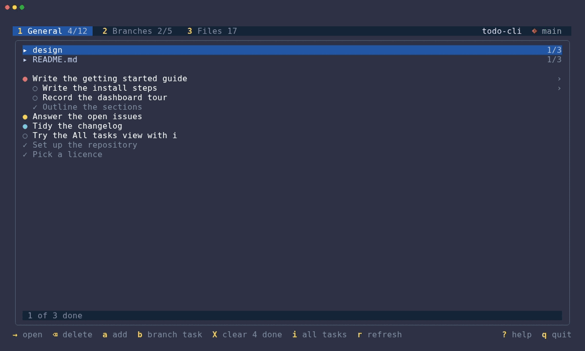
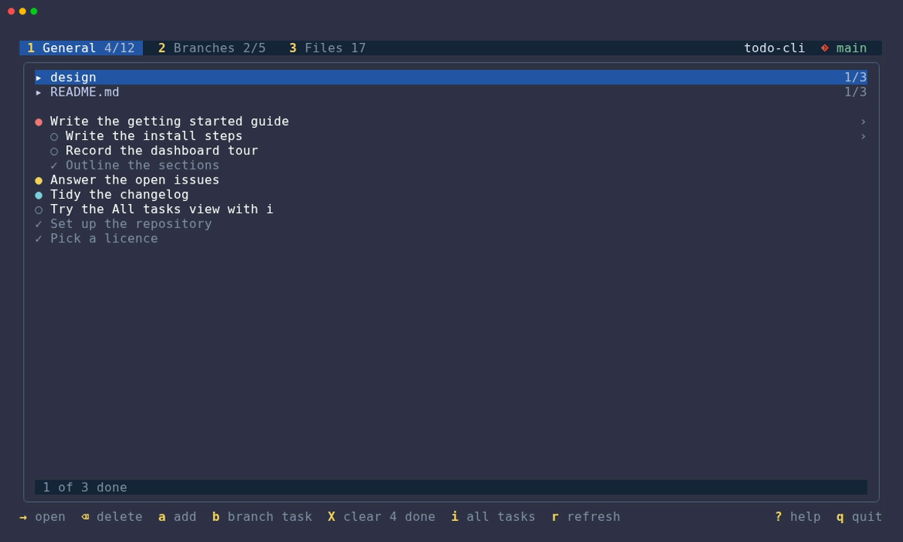
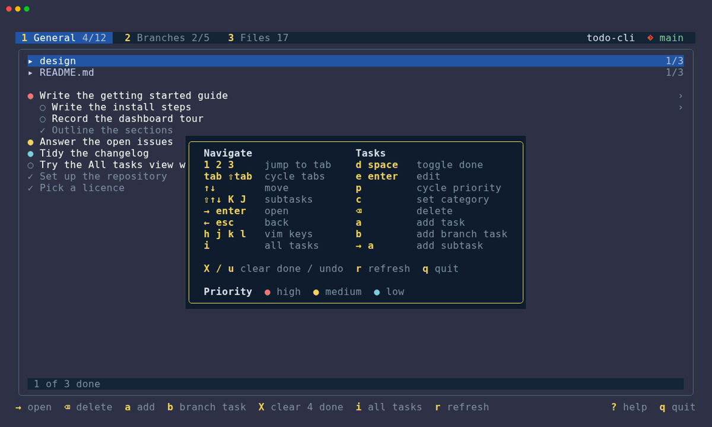
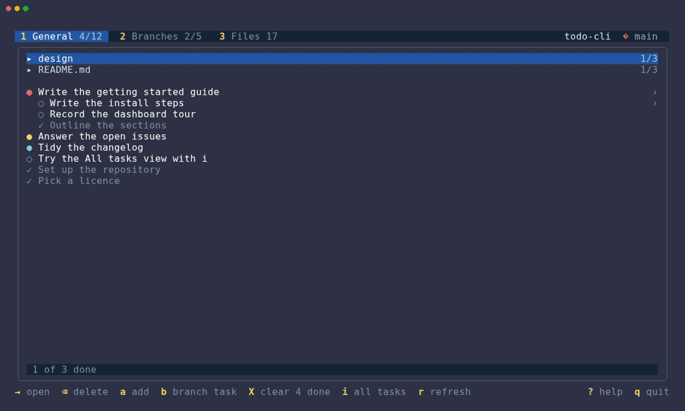
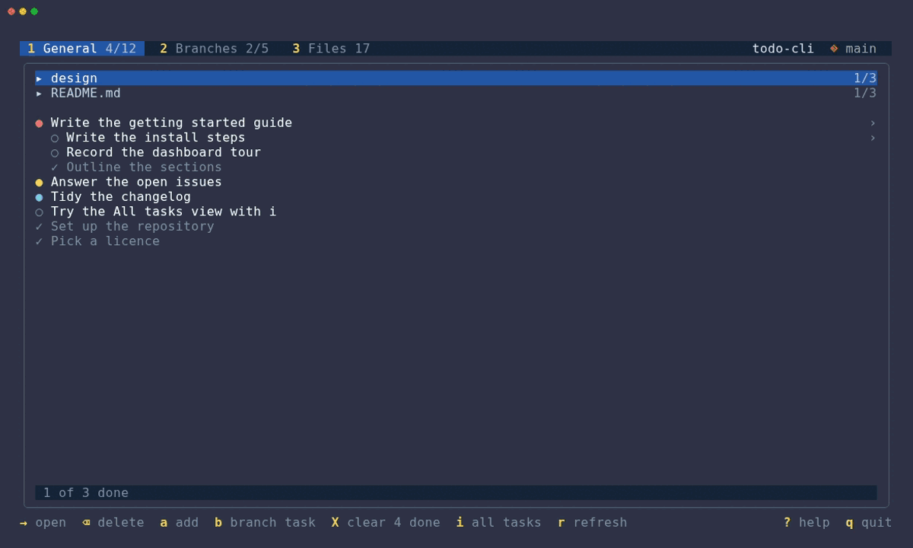
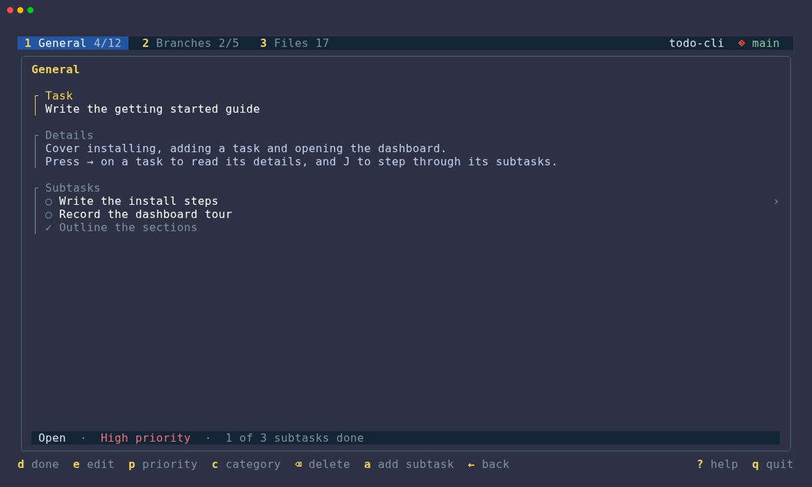
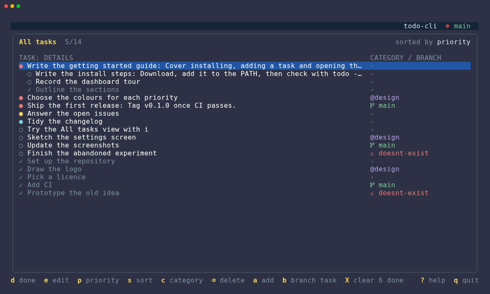
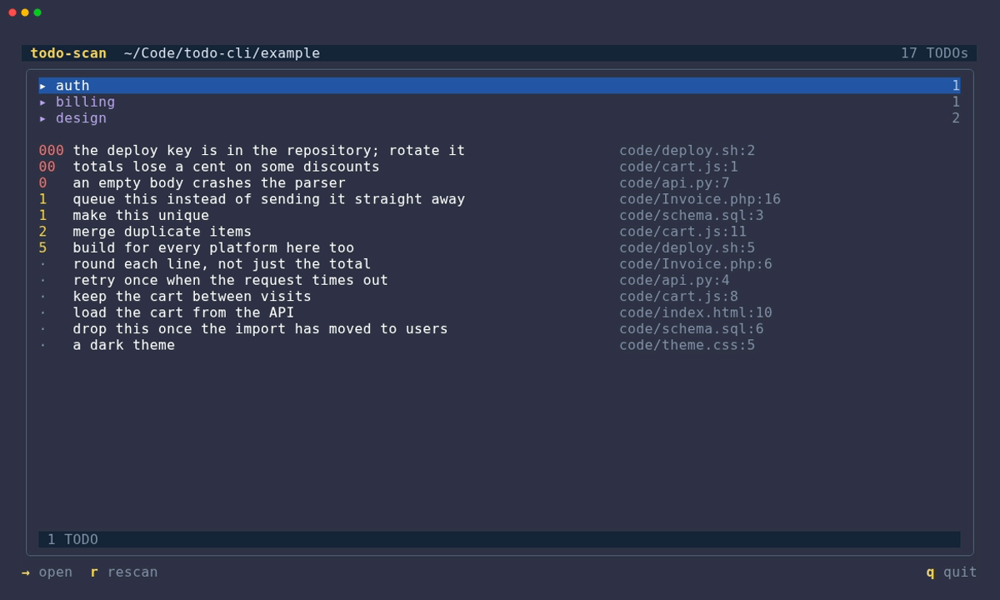

# Simple task management in the terminal

`todo` is a terminal dashboard for your tasks, kept in a plain Markdown file next to your code and shown alongside the TODOs in your README and code comments. It also adds tasks straight from the command line.



[`todo-scan`](#todo-scan) is the dashboard's Files tab on its own: it browses or lists the TODO comments in any directory, and can fail a CI build while any remain. The two commands are independent, so you can delete whichever you don't need.

Both read [todo-system](https://github.com/archtechx/todo-system)'s categories (`todo@auth`) and levels (`todo0`, `todo1`). You can [read why this is a pretty cool system](https://stancl.substack.com/p/organizing-todos-in-code) on Samuel's blog.

> [!WARNING]
> The Git and branch icons need a [Nerd Font](https://www.nerdfonts.com/) in your terminal; without one they show as empty boxes.

## Install

Each [release](https://github.com/nebarg/todo-cli/releases) has both commands for macOS and Linux, on `arm64` or `amd64`. On an Apple silicon Mac:

```sh
curl -sL https://github.com/nebarg/todo-cli/releases/latest/download/todo-cli_darwin_arm64.tar.gz | tar -xz todo todo-scan
mkdir -p ~/.local/bin
mv todo todo-scan ~/.local/bin/
```

For an Intel Mac or Linux, use `darwin_amd64`, `linux_arm64` or `linux_amd64`. Or with Go:

```sh
go install github.com/nebarg/todo-cli/cmd/todo@latest
go install github.com/nebarg/todo-cli/cmd/todo-scan@latest
```

<details>
<summary>If <code>todo</code> isn't found, or you want it for every user</summary>

Add `~/.local/bin` to your `PATH`, then open a new terminal:

```sh
echo 'export PATH="$HOME/.local/bin:$PATH"' >> ~/.zshrc   # zsh, the macOS default
echo 'export PATH="$HOME/.local/bin:$PATH"' >> ~/.bashrc  # bash
```

For every user, move them to `/usr/local/bin` instead:

```sh
sudo mkdir -p /usr/local/bin
sudo mv todo todo-scan /usr/local/bin/
```

`go install` puts them in `$(go env GOPATH)/bin`, `~/go/bin` by default, or in `$GOBIN` if it's set.

</details>

<details>
<summary>If Tab after <code>todo</code> in zsh prints <code>unknown flag: --format</code></summary>

That's zsh's completion for DevTodo, a different `todo`. Turn it off by adding this to `~/.zshrc` after `compinit`:

```zsh
compdef -d todo
```

</details>

## Quick start

```sh
todo                          # open the dashboard
todo Fix the login redirect   # add a task without opening it
```

Tasks live in `todo.md` at the root of your Git repository, or in the current directory outside Git. It's created when you add the first task, and an existing `TODO.md`, in any case, is used instead.

To try the [`example`](example), which has a category, priorities, subtasks, branches, README TODOs and code comments:

```sh
cd example
todo -f todo.md   # -f, or todo would use this repository's task file
```

## Using the dashboard

### Tabs



- **1 General**: your tasks outside branches. Categories and `▸ README.md`, [your README's TODOs](#todos-in-readmemd), are rows you open, with uncategorised tasks after them.
- **2 Branches**: every branch with tasks. It opens on the current branch, if that has any.
- **3 Files**: the [TODO comments](#todo-comments) in your code, read only.

Each tab remembers where you left it. Pressing a tab's number again goes back to the top of General, out of a TODO or category in Files, and between the branch list and the current branch in Branches.

A branch Git doesn't have locally shows as `⚠ branch-name not in Git` in red, and in the status bar. Its tasks work as normal. `r` checks Git again, and opens the new current branch if you've switched.

### General keys

| Key | Action |
| --- | --- |
| `1` `2` `3` | Go to a tab |
| `tab` / `shift+tab` | Next or previous tab |
| `↑` `↓` / `k` `j` | Move, wrapping round at either end |
| `→` / `l` | Open a category, branch or task |
| `enter` | Open a category or branch, or edit a task |
| `←` / `h` / `esc` | Back |
| `i` | [All tasks](#all-tasks) |
| `r` | Re-sort the tasks, check Git again and rescan files |
| `?` | Help |
| `q` / `ctrl+c` | Quit |



### Reading the list

| Mark | Meaning |
| --- | --- |
| `●` | Priority: red high, yellow medium, cyan low |
| `○` | No priority |
| `✓` | Done |
| `›` | Has details |
| Indented | A [subtask](#subtasks) |
| `1/2` | Tasks done and in total, not counting subtasks. Files shows its TODO count, or `…` while scanning |

The status bar describes the highlighted row, and the footer shows its keys.

Rows stay put while you work. The list is sorted, open tasks first by priority, when the dashboard starts and on `r`.

### Tasks



| Key | Action |
| --- | --- |
| `a` | Add a task |
| `b` | Add a task to the current Git branch, or the branch you've opened |
| `e` / `enter` | Edit |
| `d` / `space` | Mark done, or reopen |
| `p` | Cycle the priority: high, medium, low, none |
| `c` | Change the category of a general task |
| `backspace` | Delete a task, with its details and subtasks. On a category or branch row, delete all of its tasks |
| `X` | Clear done tasks from the category or branch you've opened, the tab, or All tasks |
| `u` | Undo the last delete or clear |

`a` adds to the category or branch you've opened, to the current branch from the branch list, and to General anywhere else.

Deleting and clearing first list what will go, including any headings left empty, and `y` goes ahead. Clearing takes a done task's open subtasks with it. `u` undoes either, as long as the file hasn't changed since.

[README tasks](#todos-in-readmemd) can only be marked done or reopened.

### The task form



The form has Task, Category (Branch for a branch task) and Details. End the task with `!high`, `!medium` or `!low` to give it a priority.

| Key | Action |
| --- | --- |
| `tab` / `shift+tab` | Next or previous field. In Category, fill in the suggestion first |
| `ctrl+n` / `ctrl+p` | Next or previous matching category |
| `↑` `↓` | Choose a branch |
| `enter` | New line in Task or Details, next field from Category or Branch |
| `ctrl+s` / `ctrl+enter` | Save. On a Mac, `cmd+s` / `cmd+enter` too. Only `ctrl+s` works in every terminal, and the footer shows which to use in yours |
| `esc` | Cancel |
| `ctrl+z` / `ctrl+shift+z` | Undo or redo in the field, a run of typing at a time. `cmd+z` / `cmd+shift+z` too, in terminals that pass them on |

Branch offers your local branches, then the name you've typed for a branch not created yet. Changing the category or branch moves the task, with its subtasks. Undo and redo work in the prompt `c` opens too.

### A task's details



`→` on a task shows its details and subtasks. An empty section says which key fills it, and the task keys work here too.

| Key | Action |
| --- | --- |
| `↑` `↓` | Scroll |
| `shift+↓` / `J` | Next subtask |
| `shift+↑` / `K` | Previous subtask, then the task |
| `a` | Add a subtask |
| `←` / `esc` | Back to the list |

### Subtasks

A subtask is a checkbox indented under a task. Add one with `a` on the task's details.

- A subtask can have details, but not subtasks of its own.
- It stays in its task's category or branch, so its form has no Category, and `c` doesn't work on it.
- A done task greys out its subtasks without ticking them.
- Subtasks move with their task when the list is sorted, open ones first.

### All tasks



`i` lists every task in your task file, with its category or branch. The task keys work here too.

| Key | Action |
| --- | --- |
| `s` | Sort by priority, branch or category |
| `i` / `←` / `esc` | Back |

### Your editor, and outside changes

`e` on a file or README TODO opens it in `$VISUAL`, falling back to `$EDITOR` then `vi`, at the TODO's line in Vim, Neovim, VS Code, Codium and Cursor. The dashboard reloads when the editor closes.

Changes made to the task file or `README.md` outside the dashboard, by an editor, a script or an agent, show up within a second, with each task keeping its place.

## Adding tasks from the command line


```sh
todo Update the changelog              # a general task
todo -p high Fix the login redirect    # with a priority
todo @docs Write the install guide     # in the docs category
todo -c "release notes" Draft v2 notes # in a category with spaces
todo -b . Fix the flaky test           # on the current Git branch
todo -f ~/notes/todo.md Renew passport # in another task file
todo --clear-done                      # remove done tasks
todo --clear-missing                   # remove the tasks of branches not in Git
```

Flags come first, and everything after them is the task. Quote a task with an apostrophe, as in `todo "Don't forget the milk"`, use `-p` rather than a trailing `!high`, which your shell may take as history, and put a task starting with `-` after `--`.

| Flag | Effect |
| --- | --- |
| `-p`, `--priority h\|high\|m\|medium\|l\|low` | Priority of the new task |
| `-c`, `--category name` | Category of the new task. `@name` works too, for names without spaces |
| `-b`, `--branch name` | Git branch of the new task, or `.` for the current one. A branch Git doesn't have works too |
| `-f`, `--file path` | Use another task file |
| `-e`, `--exclude dir` | Skip a directory in the Files tab. See [Skipping directories](#skipping-directories) |
| `--clear-done` | Remove done tasks, with their subtasks, and done subtasks |
| `--clear-missing` | Remove the tasks of branches Git doesn't have locally, open or done, with their headings. Needs Git |
| `--version` | Print the version |
| `-h`, `--help` | Show usage |

Branch tasks can't have a category, and `Branches` can't be a category name.

## Task file format

```md
- [ ] Generic task

# tests

- [ ] Test login failures !high

  When a session expires, signing in again returns to the wrong page.
  Expected: return to the page the user was viewing.

  - [ ] Reproduce it in a test

    Sign in with a session that has just expired.

  - [x] Find the redirect handler

# Branches

## feature/login

- [ ] Fix the flaky login test
```

- **Sections:** tasks before the first heading are general. A `## name` under `# Branches` is a branch, with any headings inside it. Any other heading is a category.
- **Categories** can contain spaces. `auth`, `@auth`, `#auth` and `AUTH` are the same category, and so are `Release  Notes` and `release notes`.
- **Details** are everything under a task except its subtasks. The app writes them indented two spaces further than the task.
- **Subtasks** are checkboxes indented under a task, one level deep: anything under a subtask, checkboxes included, is its details.
- **Priority** is a trailing `!high`, `!medium` or `!low`. `Ship it!` and `Fix !important CSS` don't have one.
- **Plain list items**, such as `- Buy milk`, are tasks too, and get a checkbox when you edit them.
- **Formatting:** `**bold**`, `*italic*`, `~~strikethrough~~` and `` `code` `` show formatted, as do `__bold__`, `_italic_` and `~strikethrough~`. Struck-through text is greyed out too, for terminals without strikethrough. Code blocks in details show as written.

When the app writes a task, it sorts that task's section by priority: high, medium, low, then none. Everything else stays as you wrote it, including the order of tasks with the same priority, done tasks, notes, headings and compact lists.

## TODOs in README.md

The dashboard also reads the TODO list in the `README.md` next to your task file, following todo-system's rules for READMEs. Its tasks are under `▸ README.md` in General, and aren't copied into `todo.md`.

```md
## TODOs

- Write the install guide
- [ ] todo0 Fix the broken example
  - the link to the API docs is a 404
  - [ ] Check the other links

### Dashboard

- [ ] Show the README's headings
```

- Tasks are the list items under a heading called `TODO` or `TODOs`, in any case, with or without a `:`, up to the next heading of the same level or higher.
- A deeper heading, such as `### Dashboard`, groups the tasks under it in a row of its own. todo-system itself stops at any heading.
- Nested items are [subtasks](#subtasks), such as `Check the other links`, except plain items under a checkbox task, like the 404 note, which are its details.
- Code blocks are skipped.

`d` marks a README task done or reopens it, changing only its checkbox, and `e` opens the README at the task. Nothing else changes your README.

## TODO comments

The Files tab and `todo-scan` list case-insensitive `TODO` and `@todo` comments, with their file and line. A marker counts at the start of a comment, as in `// TODO fix`, or before `:` or `(`, so `* @return todo` doesn't. [todo-system markers](#todo-system-syntax) count anywhere in a comment.

`→` opens a TODO with the code around it, and `e` opens the file in your editor.

- Only comments count, read with the comment syntax for each file's extension, so `class Todo {`, `"TODO"` and CSS's `#todo` don't. Comments over several lines are followed to their end.
- A file with PHP in it is read as PHP, whatever its extension, and HTML and template files count the comments in their scripts and styles. Files of other types are read a line at a time.
- Gitignored, binary and Markdown files, files over 1 MB, and directories starting with `.` are skipped.

### todo-system syntax

| Marker | Meaning |
| --- | --- |
| `todo@boundary Split this` | Category: listed under a `▸ boundary` row |
| `todo000`, `todo00`, `todo0` | Priority levels: the more zeros, the more urgent |
| `todo1` … `todo9` | Lower priority levels, in order |
| `TODO: fix`, `todo refactor` | Generic |

- Levels come first, most urgent at the top. Zero levels are red, and the others yellow. Four or more zeros show as `0x4` to `0x9`, then `0x9+`.
- A TODO has a category or a level, not both, so `todo1@boundary` is just in `boundary`.
- Levels todo-system doesn't accept, such as `todo11`, count as generic TODOs.

### Skipping directories

`node_modules` and `vendor` are skipped by default. Give `-e` / `--exclude` once per directory, to `todo` or `todo-scan`, to skip others instead:

```sh
todo -e node_modules -e vendor -e dist
todo-scan -e ./web/generated
```

A bare name, such as `dist`, skips every directory with that name, and a path with a slash is from the working directory.

## todo-scan



`todo-scan` is the Files tab on its own, for any directory, without a task file. It opens a browser with the Files tab's keys, plus `r` to rescan and `q` to quit, or lists and counts TODOs for scripts and CI.

```sh
todo-scan                       # browse the TODOs under the current directory
todo-scan ~/Code/api            # under another directory
todo-scan --list                # print them as path:line: text, most urgent first
todo-scan --check               # print how many there are, and exit 1 if any
todo-scan --list --check        # the list on stdout, the count on stderr
todo-scan --level 0+ --check    # only todo0, todo00 and so on
```

A CI step that fails while any levelled TODOs remain:

```yaml
- name: No levelled TODOs
  run: todo-scan --list --check --levels
```

| Flag | Effect |
| --- | --- |
| `--list` | Print every TODO as `path:line: text`, most urgent first |
| `--check` | Print how many TODOs there are, and exit 1 if any. With `--list`, the count goes to stderr |
| `--levels` | Only levelled TODOs, `todo0` to `todo9` |
| `--level level` | Only this level: `0` for `todo0`, `00` for `todo00`, `0+` for any number of zeros. Repeat it, or separate levels with commas |
| `-e`, `--exclude dir` | Skip a directory. See [Skipping directories](#skipping-directories) |
| `--version` | Print the version |
| `-h`, `--help` | Show usage |

Errors, such as a missing directory, exit 2.

## Development

```sh
go run ./cmd/todo
go test ./...
go tool -modfile=tools/go.mod golangci-lint run ./...
go tool -modfile=tools/go.mod govulncheck ./...
```

The linter and govulncheck are pinned in `tools/go.mod`, and the linter is configured in `.golangci.yml`.
